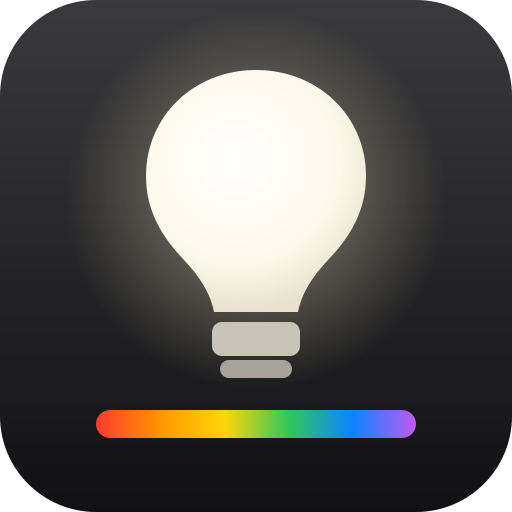

# ioBroker.philips-hue

[](https://www.npmjs.com/package/iobroker.philips-hue)
[](https://www.npmjs.com/package/iobroker.philips-hue)


## Philips Hue adapter for ioBroker
This adapter connects your [Philips Hue](https://www.philips-hue.com) bridge with ioBroker. It controls Philips Hue lights, Friends of Hue lamps, plugs and
other Zigbee lights paired with the bridge, and provides the states of Hue sensors, switches and dials.

The adapter is built on the **Hue API v2** (CLIP v2):
- State changes are pushed by the bridge in real time via its event stream, no polling is needed.
- Commands respect the rate limits of the bridge. Commands for the same light which are still waiting are merged into a single request.
- Rooms, zones, scenes, smart scenes, entertainment areas and automations of the Hue app are supported.

Requirements: Hue bridge v2 (square model) or newer, js-controller >= 6.0.11, Admin >= 7.6.20, Node.js >= 22.

## Installation
Install the adapter like any other adapter from the ioBroker Admin interface (*Adapters*), then create an instance.
Updates are installed the same way; the instance and its settings are kept.

As long as the adapter is not listed in the ioBroker repository, use *Install from custom URL* in the *Adapters* tab
(enable the expert mode if necessary) and enter the package name `iobroker.philips-hue`.

## Setup
1. Create an instance of the adapter and open its settings.
2. Select your bridge in the field "Bridge address". The adapter searches for bridges via mDNS and the Hue discovery service
   (the instance has to be running for this). You can also enter the IP address manually. If the bridge is only reachable via a
   different port (e.g. behind a port forwarding), use `host:port`.
3. Press the round link button on your bridge and click "Pair with bridge" within 30 seconds. The field "Application key" is filled in automatically.
4. Save the settings. The adapter creates all objects and keeps them in sync with the bridge.

### Settings
| Name                    | Description                                                                                                                                  |
|-------------------------|----------------------------------------------------------------------------------------------------------------------------------------------|
| __Bridge address__               | IP address or host name (optionally `host:port`) of your Hue bridge.                                                                   |
| __Application key__              | Key of this instance on the bridge. It is filled in automatically by "Pair with bridge".                                                |
| __Skip rooms and zones__         | Do not create rooms, zones and the group `all`.                                                                                         |
| __Skip scenes__                  | Do not create scenes and smart scenes.                                                                                                  |
| __Switch on with color changes__ | Also switch lights on when color, color temperature or effect is changed. If disabled, lights are only switched on via `on` and `brightness`. |

### Objects
Object ids are derived from the names in the Hue app. Once created, an id is kept even if you rename the device in the Hue app,
so your scripts keep working. To get a new id after a rename, delete the object and restart the adapter.
Objects of devices which are removed from the bridge are deleted automatically. Objects with custom settings (e.g. history) are kept and reported in the log, delete them manually if they are not needed anymore.

| Object                                  | Description                                                                         |
|-----------------------------------------|-------------------------------------------------------------------------------------|
| `philips-hue.0`                                 | The instance itself, named like the bridge                                          |
| `philips-hue.0.lights.<name>`                   | A light                                                                             |
| `philips-hue.0.rooms.<name>`                    | A room of the Hue app                                                               |
| `philips-hue.0.zones.<name>`                    | A zone of the Hue app                                                               |
| `philips-hue.0.all`                             | All lights of the bridge                                                            |
| `philips-hue.0.rooms.<name>.scenes.<scene>`     | Button to activate a scene (same for zones)                                         |
| `philips-hue.0.rooms.<name>.smartScenes.<name>` | Switch to start/stop a smart scene (same for zones)                                 |
| `philips-hue.0.sensors.<name>`                  | Motion sensors, contact sensors, switches, dials, ...                               |
| `philips-hue.0.entertainment.<name>`            | Switch to start/stop streaming of an entertainment area                             |
| `philips-hue.0.automations.<name>`              | Switch to enable/disable an automation of the Hue app                               |

#### Lights, rooms and zones
States are only created if at least one light supports the feature.

| State              | Writable | Description                                                                                       |
|--------------------|:--------:|---------------------------------------------------------------------------------------------------|
| `on`               |    ✓     | On/off. For rooms and zones `true` means that at least one light is on                            |
| `allOn`            |          | Rooms and zones only: all lights are on                                                           |
| `brightness`       |    ✓     | Brightness in %. Values > 0 turn the light on, 0 turns it off                                     |
| `colorTemperature` |    ✓     | Color temperature in Kelvin                                                                       |
| `xy`               |    ✓     | Color as CIE xy coordinates, e.g. `[0.4573, 0.41]`                                               |
| `rgb`              |    ✓     | Color as hex value, e.g. `#FF8800`. Only the color is set, use `brightness` for the brightness    |
| `colorMode`        |          | Lights only: `ct` (color temperature) or `xy` (color)                                             |
| `effect`           |    ✓     | Lights only: effect like `candle` or `fire`, `no_effect` stops it. Possible values depend on the light |
| `alert`            |    ✓     | Let the light(s) breathe once to identify them                                                    |
| `reachable`        |          | Lights only: the light is reachable by the bridge                                                 |
| `activeScene`      |          | Rooms and zones only: name of the active scene, empty if none is active                           |
| `command`          |    ✓     | Change several properties at once, see below                                                      |

For rooms and zones the bridge does not report color, color temperature and effect, so these states only show the last value set by ioBroker.

#### Sensors
| State           | Writable | Description                                                                                    |
|-----------------|:--------:|------------------------------------------------------------------------------------------------|
| `motion`        |          | Motion detected                                                                                |
| `motionEnabled` |    ✓     | Enable/disable the motion detection                                                            |
| `temperature`   |          | Temperature in °C                                                                              |
| `illuminance`   |          | Illuminance in lux                                                                             |
| `open`          |          | Contact sensor is open                                                                         |
| `tampered`      |          | Sensor has been tampered with                                                                  |
| `button<n>`     |          | Last event of button n: `initial_press`, `repeat`, `short_release`, `long_release`, `long_press`, `double_short_release`. The state is updated on every press, even if the value stays the same |
| `rotary`        |          | Steps of the last rotation of a dial, negative values mean counter clockwise                  |
| `battery`       |          | Battery level in %                                                                             |
| `lowBattery`    |          | Battery is low                                                                                 |
| `reachable`     |          | Device is reachable by the bridge                                                              |

### Commands
The `command` state of a light, room or zone accepts a JSON object to change several properties with a single request.
Supported keys are `on`, `brightness`, `brightnessDelta`, `colorTemperature`, `xy`, `rgb`, `effect`, `alert`, `transition` (in milliseconds) and, for rooms and zones, `scene`.

```javascript
// dim to 30 % with a warm white within 2 seconds
setState('philips-hue.0.lights.Desk.command', JSON.stringify({ brightness: 30, colorTemperature: 2700, transition: 2000 }));

// increase the brightness of a room by 10 %
setState('philips-hue.0.rooms.Living_room.command', JSON.stringify({ brightnessDelta: 10 }));

// activate a scene by name (or id) with a transition time of 3 seconds and 60 % brightness
setState('philips-hue.0.rooms.Living_room.command', JSON.stringify({ scene: 'Relax', transition: 3000, brightness: 60 }));
```

### Switching from the hue adapter
This adapter is an independent development and **not compatible** with the `hue` adapter from the ioBroker repository. Both can be installed in parallel:
- The object structure is different, scripts, visualizations, aliases and history settings have to be adjusted when switching.
- Brightness is set in % (`brightness`), color temperature in Kelvin (`colorTemperature`) and colors as hex (`rgb`) or CIE xy (`xy`).
  The Hue API v2 does not support hue/saturation.
- Button events are reported as text (e.g. `short_release`) instead of numeric codes.
- CLIP software sensors are not supported by the Hue API v2. Automations of the Hue app can be enabled and disabled below `automations` instead.
- Pair each adapter instance separately with the bridge, so every instance has its own application key.

## Development
See [DEVELOPMENT.md](DEVELOPMENT.md).

## Changelog
### 0.1.0 (2026-11-26)
- (Exc3pt10n) Initial release: Philips Hue adapter based on the Hue API v2 with event stream

## License
MIT License, see [LICENSE](LICENSE).

Copyright (c) 2026 Exc3pt10n

Philips and Hue are trademarks of Signify. This project is not affiliated with or endorsed by Signify.
